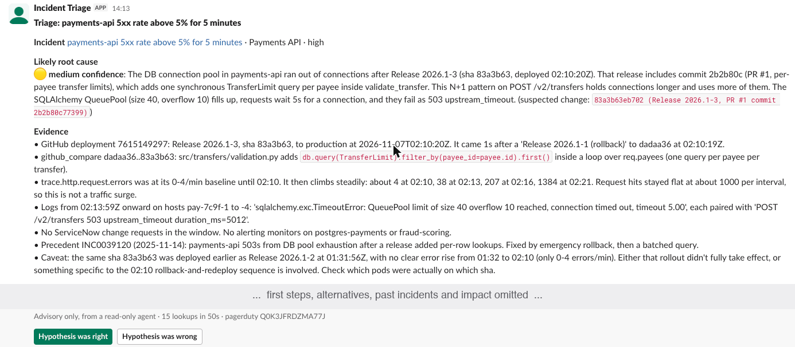

# Incident triage agent

> **Status:** reference implementation, tested end to end on test accounts using synthetic incidents. It hasn't been
> evaluated on real incidents here. See the [production readiness checklist](#production-readiness-checklist) before
> using it for real.

When PagerDuty or ServiceNow opens a new incident, this service has Claude investigate it with
read-only access to the service catalog, Datadog, GitHub, ServiceNow and PagerDuty. Claude then posts a
root-cause hypothesis, its evidence and suggested first runbook steps to the on-call Slack channel.
The target is under two minutes from alert to post.

```
PagerDuty / ServiceNow      a new incident opens
        │  signed webhook, or token-protected request
        ▼
Public address              your ingress (a temporary tunnel when testing on a laptop)
        ▼
Intake service              verifies, normalises, drops duplicates, replies 202
        ▼
Agent loop  ◄──►  Claude    decides what to look at next
        │
        ├─ Service catalog  which repo, tags and CI belong to this service
        ├─ GitHub           what was deployed, and what changed
        ├─ ServiceNow       change requests, past incidents, runbooks
        ├─ Datadog          logs, metrics, monitors, events
        └─ PagerDuty        raw alerts, recent incidents
        │  (every external call passes through the read-only guard)
        ▼
submit_triage               structured report, checked against a schema
        ▼
Slack post  ──►  on-call clicks right/wrong  ──►  feedback log
```

**Example Slack post** (from a synthetic test incident, with the middle sections left out):



## Quick start

You can try it with only an Anthropic API key. This replays three synthetic incidents from recorded data, so it needs
no other accounts, and costs a few cents in API usage.

```bash
python -m venv .venv && source .venv/bin/activate
pip install -e ".[dev]"
export ANTHROPIC_API_KEY=your-key
triage-eval --limit 3
```

Connecting real systems is covered under [Setup](#setup).

## Benefits

On-call engineers start from an evidence-backed hypothesis instead of spending the first half hour digging
across several tools.

This repo ships only synthetic test data, so it can't show accuracy on real incidents. On recorded test incidents,
a triage on Claude Sonnet 5.5 takes about 15–17 seconds; live lookups will add time. To measure your own results, use the eval set for accuracy
and the feedback log for how often on-call engineers accept the first hypothesis.

**For on-call engineers**

- **All the evidence in one place:** deploys, change requests, logs, metrics and past incidents are checked and
  summarised together.
- **A concrete starting point:** each post names a likely cause, a confidence level, the evidence and the first
  steps to try.
- **Help with non-obvious causes:** checking both GitHub and ServiceNow surfaces network or database changes that
  never appear in code.
- **Memory of past incidents:** it searches years of resolved incidents, including yearly recurrences such as
  certificate expiries.

**For the organisation**

- **Less customer impact:** faster diagnosis usually means faster recovery, though the time saved also depends on
  the fix.
- **Low operational risk:** the agent can't change anything. Fixes stay with engineers and go through change
  management.
- **Easier knowledge sharing:** newer engineers get guidance drawn from runbooks and past incidents.
- **Measurable performance:** the eval set and feedback log show whether it's improving.

**Limits**

- **It can be wrong:** engineers still have to verify each hypothesis, and a confident wrong answer can cost time.
- **Diagnosis only:** it doesn't fix anything, so total recovery time depends on the rest of your process.
- **It needs upkeep:** results depend on the service catalog, runbooks and good incident close notes.
- **It has running costs:** every triage is paid Claude API usage, so alert-heavy services add up.

## Cost vs. benefit

Token counts come from synthetic test runs. Your costs will vary.

**Cost per triage.** Mean of three synthetic runs on Claude Sonnet 5.5, at $2/$10 per million input/output tokens
with cached reads at $0.20 and cache writes at $2.50 (assumed 1.25× input price):

| Item | Tokens (approx.) | Cost |
|---|---|---|
| Output | 2,200 | $0.022 |
| Cache writes | 7,300 | $0.018 |
| Cached reads | 16,400 | $0.003 |
| **Total** | | **about $0.04** |

Real logs and code diffs are larger. Tool output is capped at 20,000 characters per call, so a heavy run with 15
full-size results would cost roughly $0.30 by estimate. The audit log records each run's estimated cost in `estimated_cost_usd`.

**Other costs and benefits to weigh:**

| Possible upside | Possible downside |
|---|---|
| Less downtime: P1 incidents × minutes of recovery saved × cost per minute | Time lost to wrong hypotheses |
| Fewer escalations and less on-call fatigue | Engineers trusting it too readily |
| Faster onboarding of new engineers | Incident data going to an outside API, plus vendor risk review |
| Better close notes and runbooks, because they now get used | Ongoing audit and approval work |

Avoided downtime could be the largest benefit, but only if faster diagnosis actually shortens the outage. Measure
minutes saved on your own incidents to judge whether it's worth running.

## How it works

1. **An incident fires.** PagerDuty sends a v3 webhook on `incident.triggered`, signed with the webhook's
   signing secret. In ServiceNow, a business rule on new P1 and P2 incidents sends a webhook with a shared
   token.
2. **Intake accepts it** ([triage/intake.py](triage/intake.py)). It rejects anything without a valid
   signature or token, converts either source's payload into one common `Alert`, and drops repeat
   deliveries of the same incident. It returns 202 straight away and starts triage in the background.
3. **The agent investigates** ([triage/agent.py](triage/agent.py), [triage/prompts.py](triage/prompts.py)).
   Claude Sonnet 5.5 (`claude-sonnet-5-5`) receives the alert, then repeatedly picks tools, reads the results and decides what to
   check next. Independent tool calls run in parallel. A typical investigation:
   - **Find the service:** look it up in the catalog.
   - **Look for changes:** check deployments, change requests and events from before the alert.
   - **Test each suspect:** compare error logs and metrics against the timing. A deploy that landed after
     the errors began isn't the cause.
   - **Check history:** search past incidents and runbooks.
4. **Tools fetch the evidence** ([triage/tools/](triage/tools/)):

   | Source | What the agent gets |
   |---|---|
   | Service catalog | The service's repo, Datadog tags, CI name, runbook and dependencies |
   | GitHub | Deployments, commits, code diffs and PRs |
   | ServiceNow | Change requests, resolved incidents with close notes, knowledge articles |
   | Datadog | Logs, metric trends, alerting monitors, deploy and config events |
   | PagerDuty | The incident's raw alerts, recent incidents on the service |

5. **The agent submits a report.** It finishes by calling `submit_triage`, a strict tool with a fixed
   structure: root cause, confidence, evidence, alternative causes, runbook steps, similar incidents and
   likely impact. The loop validates the report before accepting it.
6. **Slack shows the result** ([triage/slack.py](triage/slack.py)). The report goes to the on-call channel,
   with text escaped so a log line can't trigger `@channel`. If triage fails, on-call gets a short "could
   not analyse" notice instead of silence.
7. **On-call gives feedback.** Clicking **Hypothesis was right** or **Hypothesis was wrong** sends a signed
   request to `/slack/actions`, which appends it to `TRIAGE_FEEDBACK_LOG`. That file is where the
   acceptance rate is measured.

Three behaviours of the loop worth knowing:

- **Time budget:** once `TRIAGE_TIME_BUDGET_S - 25s` has passed, a mid-conversation system message tells
  Claude to stop investigating and submit. This keeps the whole run inside the SLA.
- **Prompt caching:** the system prompt and tool list never change from one request to the next, so after
  the first turn each request reads them from cache.
- **Refusals:** server-side `fallbacks: "default"` is on. A request that's still refused counts as a failed
  triage and gets the notice in step 6.

Two tools sit outside the live flow. The eval ([triage/eval/](triage/eval/)) replays past incidents and has
Claude grade each result against the known root cause, which gives you an accuracy number. `triage-export`
pulls resolved ServiceNow incidents into a CSV for building those eval cases.

## Why it can't change anything

| Layer | Where | What it stops |
|---|---|---|
| Tool surface | [triage/tools/](triage/tools/) | The model is offered read tools only. None of them create, update or delete. |
| HTTP guard | [triage/permissions.py](triage/permissions.py) | Every tool client goes through `ReadOnlyTransport`, which allows GET/HEAD and a short list of read-only POST paths (Datadog search). Any other request raises `WriteAttemptBlocked` before it leaves the process, even if a tool has a bug or the model is fed injected arguments. |
| Argument checks | tool modules | GitHub repos must be in the service catalog. ServiceNow record numbers and PagerDuty IDs are checked against a pattern. Characters that could break out of a ServiceNow encoded query are stripped. |
| Credentials | `.env.example` | Datadog app key with `*_read` scopes, a fine-grained GitHub token with read access, a ServiceNow user with `snc_read_only`, and a read-only PagerDuty key. |
| Prompt | [triage/prompts.py](triage/prompts.py) | Tool output is treated as data, not instructions. Remediation is phrased as recommendations that go through change management. Secrets and customer data are not copied into the post. |
| Output | `slack.esc` | Model text is escaped so a log line can't trigger `@channel` or a disguised link. |

The only thing the service writes outside itself is a Slack message (`chat.postMessage`) to one configured
channel, plus its own local feedback log. A Datadog API key can send data to Datadog by design; the HTTP guard
stops the agent's tools from doing so. Check every new key with a write attempt: a PagerDuty key created
without the read-only box ticked has full access.

## Production safeguards

| Safeguard | What it does | Setting |
|---|---|---|
| Redaction ([triage/redaction.py](triage/redaction.py)) | Removes card numbers, emails, account numbers, IBANs, SSNs, phone numbers and credentials from alerts and tool output before Claude sees them, and again from Slack posts and the audit log | Always on |
| Limits ([triage/safeguards.py](triage/safeguards.py)) | Caps simultaneous triages, waiting incidents and triages per day, which also caps API spend. Refused incidents are logged, and Slack gets at most one notice every 10 minutes | `TRIAGE_MAX_CONCURRENT`, `TRIAGE_MAX_QUEUED`, `TRIAGE_MAX_PER_DAY` |
| Audit trail | Writes one JSON record per incident: status, model, prompt version, tool calls, token usage, estimated cost and the report | `TRIAGE_AUDIT_LOG` |
| Kill switch | While this file exists, new incidents aren't triaged. It takes effect without a restart: `touch data/TRIAGE_DISABLED` | `TRIAGE_KILL_SWITCH_FILE` |

## Production readiness checklist

A ticked box means this repo includes the feature and tests for it, not that your deployment has been verified.
Everything else depends on your environment. Items in **Launch blockers** should all be done before go-live.

### Launch blockers

- [ ] Sending logs, incidents and code diffs to the Claude API is approved, covering vendor risk, residency and retention
- [x] Redaction of structured values (cards, emails, account numbers, credentials) is in place
- [ ] Security has tested redaction on a sample of real data, including names and free text, which patterns can't catch
- [ ] A real-incident eval has run, with launch thresholds agreed in advance, especially high-confidence precision
- [ ] Shadow mode has run for 2–4 weeks in a private channel and been compared with what engineers found
- [x] A kill switch stops new triages without a restart
- [ ] The kill switch has been tried in your environment, and on-call knows how to use it

### Hosting and reliability

- [ ] Runs on your approved platform, behind your ingress with TLS, not a tunnel
- [ ] Webhook sources are allowlisted, with rate limiting at the ingress
- [ ] Webhooks have replay protection beyond the one-hour duplicate check
- [ ] Duplicate detection and limits use a shared store, so they survive restarts and work across replicas
- [x] Limits cap simultaneous triages, waiting incidents and triages per day
- [ ] Limits are tuned to your incident volume, API rate limits and budget
- [ ] When the agent, Claude or a tool is down, on-call still gets a notice and works normally
- [ ] The agent isn't a required step in your incident process

### Access and secrets

- [ ] Secrets are in your secrets manager, with rotation, and test credentials aren't reused
- [ ] ServiceNow uses OAuth, not password login
- [ ] GitHub, Datadog, ServiceNow and PagerDuty credentials are read-only, and each refused a write attempt in testing
- [ ] GitHub access is limited to repos in the service catalog
- [ ] The Slack bot has only `chat:write`
- [ ] The Slack channel is limited to people approved to see incident details
- [x] An HTTP guard blocks writes from the agent's tools, and Slack text is escaped
- [ ] Security has tested prompt injection using hostile log lines and tickets

### Audit and monitoring

- [x] Each incident gets an audit record: status, model, prompt version, tool calls, tokens and report
- [ ] Audit and feedback logs are in central storage, with retention rules agreed with compliance
- [ ] Application logs have been reviewed for sensitive data
- [ ] Failures, latency, cost per triage, tool errors and acceptance rate are monitored, with alerts on drift
- [ ] Someone is notified when triages are refused because a limit was reached

### Operations and governance

- [ ] A named owner is responsible for the service, catalog and runbooks
- [ ] The service catalog is complete for every service in scope
- [ ] Any model or prompt change goes through change control, with the eval rerun first
- [ ] Third-party risk, security review, penetration test and any model risk governance are complete
- [ ] On-call engineers are trained to verify each post, and over-trust is reviewed
- [ ] Rollout is phased: one or two services first, adding more only while thresholds hold

## Setup

```bash
python -m venv .venv && source .venv/bin/activate
pip install -e ".[dev]"
cp .env.example .env      # fill in credentials, then: set -a; source .env; set +a
pytest                    # offline tests: no API calls
```

1. **Service catalog.** Fill in [config/services.yaml](config/services.yaml): repo, Datadog tags,
   ServiceNow CI, PagerDuty service ID, runbook URL and dependencies for every service that pages.
   Triage quality depends heavily on this file.
2. **Try one incident without Slack:**
   `triage-once --title "payments-api 5xx above 5%" --service payments-api --at 2026-04-02T14:05:00Z`
3. **Run the service:** `triage-serve` listens on `127.0.0.1:8080`. Set `TRIAGE_HOST` and `TRIAGE_PORT` to change that, and put it behind your ingress with TLS.
4. **PagerDuty:** add a v3 webhook subscription for `incident.triggered` pointing at `/webhooks/pagerduty`,
   and set `PAGERDUTY_WEBHOOK_SECRET` to its signing secret.
5. **ServiceNow:** add an outbound REST message, fired by a business rule on incident insert (filter by
   priority as you like). It should POST `number`, `short_description`, `cmdb_ci`, `priority`,
   `opened_at` (UTC) and optionally `url` and `description` to `/webhooks/servicenow`, with header
   `X-Triage-Token: $SNOW_WEBHOOK_TOKEN`. [config/servicenow_business_rule.js](config/servicenow_business_rule.js)
   is a ready-made rule.

   A business rule on the incident table does the sending (async, on insert, `priorityIN1,2`), using
   `sn_ws.RESTMessageV2`. Keep the address and token in admin-only system properties rather than the script.

   The integration user needs the following. All of it was verified on a developer instance on the
   Australia release:
   - **Identity type:** Machine (web service access only).
   - **Roles:** `snc_read_only` and `itil`. `itil` grants read access to incidents, changes and
     problems; `snc_read_only` blocks every write, so ServiceNow itself returns 403 even if the
     agent's own read-only guard were bypassed.
   - **`snc_basic_auth_api_access`:** newer releases enforce a Basic-auth restriction. Without this
     role the API returns 401 even with the correct password. If you switch the tool to OAuth, you
     don't need it.
   - **Knowledge read access:** knowledge bases are gated by user criteria, not roles. Add a user
     criteria record for the integration user to each knowledge base's "Can read" list, or
     knowledge searches return nothing.
   - **Search index:** new records take a few minutes to appear in keyword (`123TEXTQUERY321`)
     search.
6. **Slack app:** needs the `chat:write` scope and must be invited to the channel. For the feedback
   buttons, turn on Interactivity with request URL `/slack/actions`, and set `SLACK_SIGNING_SECRET`.

## Evaluation

The eval replays historical incidents through the agent. Tool calls return the responses recorded for
each incident, not live data, because production state has moved on since. Each case is a JSON file in
[evals/cases/](evals/cases/). The three `EXAMPLE-*` cases are synthetic and only show the format:

```json
{
  "id": "INC0041234",
  "alert": {"source": "servicenow", "id": "INC0041234", "title": "...", "service": "...", "triggered_at": "..."},
  "ground_truth": {"root_cause": "from the post-incident review", "culprit": "CHG0041230 or sha or null", "category": "deploy|config|infra|dependency|capacity|data"},
  "fixtures": {
    "github_deployments": [{"match": {"repo": "payments-api"}, "response": [...]}],
    "datadog_search_logs": [{"match": {"query": "status:error"}, "response": [...]}]
  }
}
```

To start from your own incidents, `triage-export --out ~/incident_export.csv --limit 20` writes resolved
incidents to a CSV with blank columns for reviewers to fill in from the post-incident review. Close notes
are a starting point, not the confirmed cause. Keep real exports out of synced folders.

A fixture entry is used when every `match` value appears, case-insensitively, in the call's arguments.
`{}` matches any call. A call with no matching entry gets `[]`. When you convert a past incident, record
what each system returned around the trigger time. Include some plausible distractors, such as an
unrelated deploy or a noisy log line, so the eval tests reasoning and not just lookup.

```bash
triage-eval --limit 3                 # smoke test
triage-eval --concurrency 4           # full run -> evals/results/<timestamp>/{results.jsonl,summary.json}
triage-eval --effort high             # compare settings on the same cases
triage-eval --cases evals/live --live servicenow,github,datadog   # real test accounts; other tools stay recorded
```

Recorded responses don't exercise a system's real search or date handling, so run with `--live` against
seeded test accounts whenever those tools change. [evals/live/](evals/live/) holds cases tied to real test
data. They're examples: they point at the author's private sandbox repo and telemetry that ages out, so they won't run
as is. To build your own, use [scripts/create_github_sandbox.sh](scripts/create_github_sandbox.sh) and
[scripts/simulate_incident.py](scripts/simulate_incident.py), then update the case's repo and alert time. GitHub doesn't
allow backdating deployments, so those cases use the sandbox deployment's actual time.

A Claude judge grades each primary hypothesis as `match`, `partial` or `miss` against the confirmed
root cause, and a deterministic check records whether the agent named the culprit change. The summary
reports:

- top-1 accuracy (failed runs count as misses)
- match-or-partial rate
- how often the culprit was named
- **high-confidence precision**, the metric to watch, because engineers act fastest on high-confidence calls
- how often the runbook was useful
- p50/p95 latency and the share of runs within the 120 s SLA
- mean tool calls
- accuracy by category

Every eval run costs money: one Claude call per agent turn plus one judge call per case.

## Operating notes

- **Duplicates:** dedupe is in memory with a one-hour TTL, so it only works with a single replica. With
  several replicas, move `Deduper` to Redis. If PagerDuty and ServiceNow both forward the same incident,
  enable only one webhook or dedupe on a shared key.
- **Tuning:** `TRIAGE_EFFORT=medium` is a good balance of speed and depth. Compare `high` on the eval
  before changing it, and watch p95 latency.
- **Logs:** every turn logs input, cache-read and output tokens. A consistently zero `cache_read` means
  something is changing the prompt prefix.
